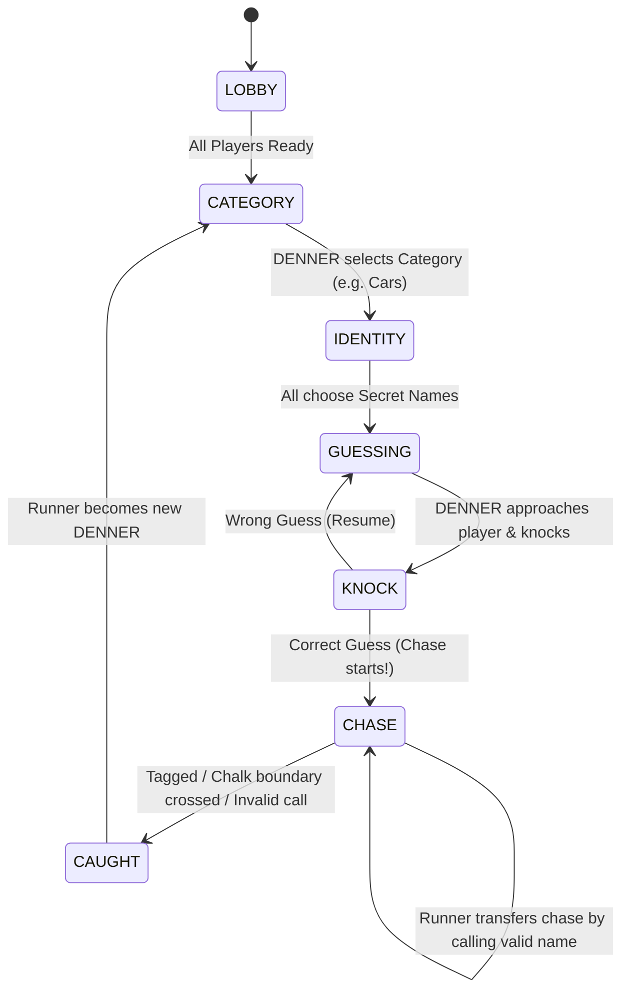

# DESIGN.md — Mohalla Courtyard & Gameplay Design

This document details the visual, artistic, and game design philosophy of **Chicklets**.

---

## 🎨 Creative Vision & Theme

**Chicklets** translates a nostalgic North Indian childhood game (*"Knock-knock, tera naam kya hai?"* / *Chicklets*) into a vibrant, warm, 3D social courtyard (*Mohalla adda*).

### Atmosphere & Aesthetic
- **Time of Day**: Warm late-afternoon / golden hour in an Indian residential colony courtyard.
- **Visual Style**: Stylized realism with rich PBR textures (cobblestone pavers, weathered plaster walls, rustic timber).
- **Cultural Detailing**:
  - PCO signboards, Hindi street lettering, and retro market facades.
  - Everyday courtyard props: charpai (woven daybed), clothesline with colorful fabrics, hand-pump, and chalk *stapu* (hopscotch) markings.
  - Authentic dialogues: *"Knock knock! Kya tum Maruti ho?"*, quick comebacks, and nickname transfers.

---

## 🕹️ Core Game Loop & State Flow

### Game Phases Explained

1. **Lobby (`LOBBY`)**:
   - Players create or join an *adda* (room link).
   - Toggle practice mode with 2–4 players or add 2–3 bot friends.
2. **Category Selection (`CATEGORY`)**:
   - The round's **DENNER** picks a category (e.g., Cars, Indian Sweets, Superheroes).
3. **Secret Identity (`IDENTITY`)**:
   - All players except the DENNER choose a unique secret name from the category.
4. **Knocking & Bluffing (`KNOCK`)**:
   - The DENNER walks up to any player and knocks: *"Knock knock! Kya tum [Guessed Name] ho?"*.
   - Movement freezes for up to 12 seconds while the addressed player types a witty reply or taps a quick comeback.
   - The server validates the guess secretly.
5. **The Chase & Name Relays (`CHASE`)**:
   - If the guess is correct, the chase begins!
   - The runner must evade the DENNER inside the chalk boundaries.
   - **The Relay Trick**: While fleeing, the runner can shout another active player's secret name (keys `1`–`7`). If valid, the chase transfers to that player, freezing the previous runner. Calling an unassigned name or your own name immediately makes you OUT.
6. **Catch & Turnover (`CAUGHT`)**:
   - Tagged by the DENNER or stepping outside the chalk lines causes an out. The caught runner becomes the next DENNER!

---

## 🎮 Controls & Ergonomics

### Desktop
- **Movement**: `W`, `A`, `S`, `D` or Arrow Keys.
- **Sprint**: Hold `Shift`.
- **Relay Calls (during Chase)**: Number keys `1`–`7` or HUD buttons.
- **Knock / Actions**: On-screen prompt or Spacebar.

### Mobile & Touch
- **Left Virtual D-Pad**: Analog 8-directional movement.
- **Right Action Button**: Sprint toggle / Knock trigger.
- **HUD Buttons**: Large touch targets for quick comebacks and secret name relays.

---

## 🧱 3D Architecture & Technical Design

- **Camera**: Third-person isometric perspective with smooth damping following the active player.
- **Lighting**: Warm directional sun with soft shadows, balanced ambient fill, and a procedural skybox gradient.
- **Optimization**:
  - Combined static geometry to minimize draw calls.
  - Instanced rendering for foliage, tree canopies, and repeated architectural props.
  - CSS3D / HTML overlays via React Three Fiber Drei for crisp speech bubbles and legible nametags without font texture blurring.

